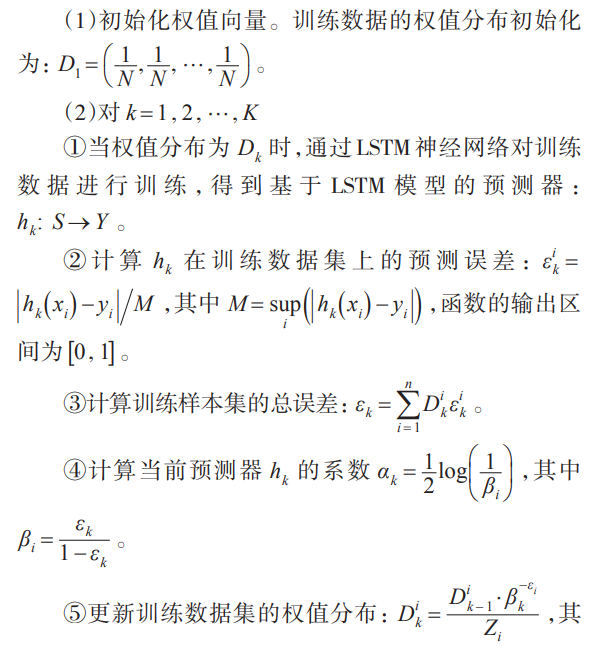
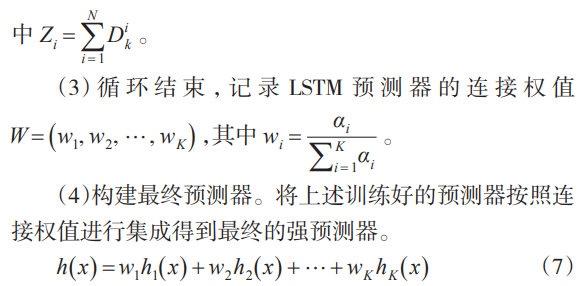
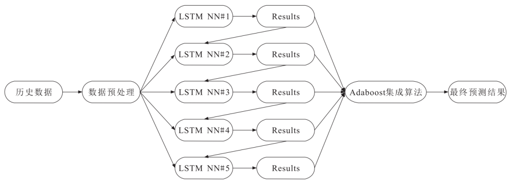
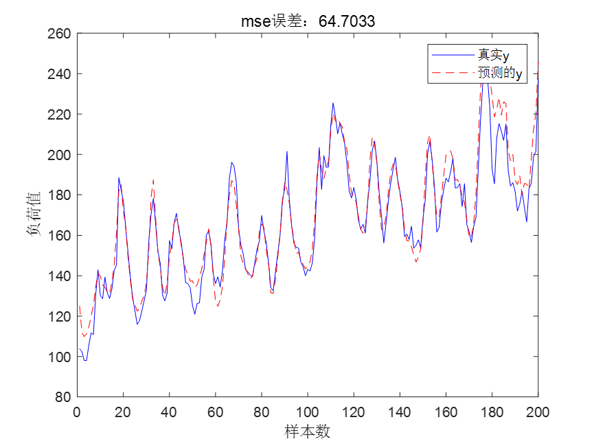
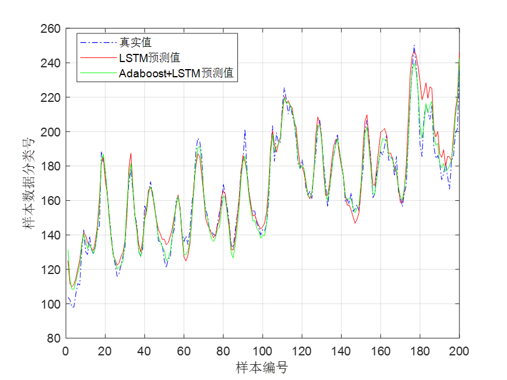
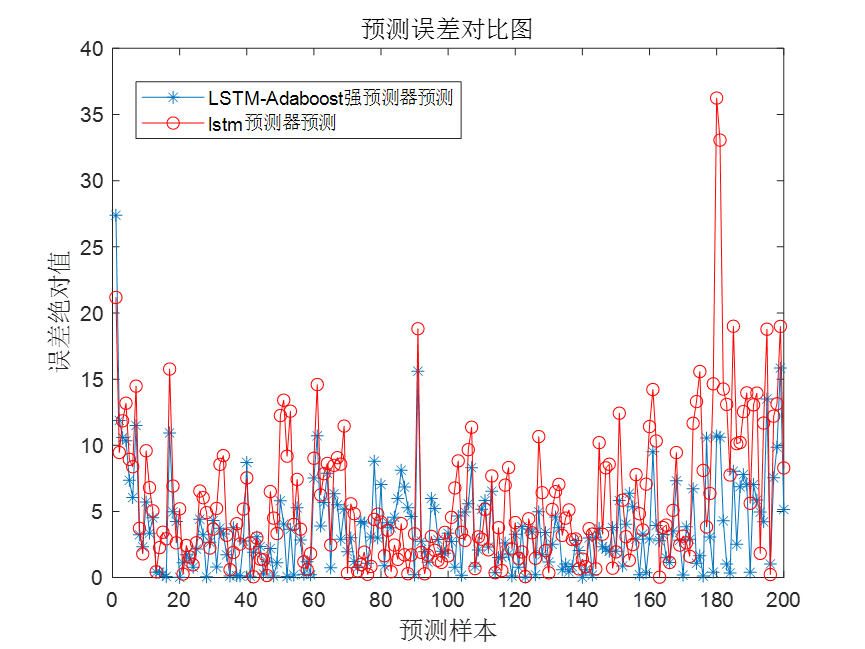

# Power Load Forecast Based on LSTM-Adaboost, with MATLAB Code

Today, we bring you a session on power load forecasting based on LSTM-AdaBoost. The LSTM in the code can be replaced with any machine learning algorithm.

Detailed Explanation:
The LSTM-AdaBoost load forecasting model first trains multiple base learners sequentially through the AdaBoost ensemble algorithm and calculates the weight coefficients for each base learner. Then, it linearly combines the predictions of these base learners to generate the final forecast result.

The algorithmic flow of the LSTM-AdaBoost model is as follows:
By using the AdaBoost algorithm, many weak predictors are aggregated into a strong predictor, and finally, the results of the weak predictors are weighted by the strong predictor to obtain the final result. The flowchart of the LSTM-AdaBoost network model is shown in the figure below:

Content Explanation:
① Processing Power Load Data:
This data includes load values, temperature, humidity, wind speed, pressure, precipitation, visibility, vapor pressure, and perceived temperature. Some screenshots of the data are as follows:
We selected 1200 samples as the training set, each sample consisting of all data from that day over 24 hours, so the input data size of the training set is 1200*216, where 216=24*9, 24 represents 24 hours, and 9 represents 9 features. The output data size of the training set is: 1200*1. 1 represents the load value for the next hour.
We selected 200 samples as the test set, similarly, the input data size of the test set is 200*216, and the output data size of the training set is: 200*1.
② Training and Predicting Power Load Data Using LSTM-AdaBoost:
The prediction results of LSTM are as follows:
It can be seen that the prediction effect of the unoptimized LSTM is not very ideal, with an MSE indicator of 64.7033, indicating a large error!
The prediction effect of the LSTM-AdaBoost model is as follows: (In this experiment, we selected 10 LSTM weak classifiers)
Error comparison chart is as follows:
It can be observed that the LSTM-Adaboost model has significantly improved its prediction performance. The MSE error of the LSTM-Adaboost model is 26.6652, which is a significant improvement compared to the previous 64.7033!
Part of the code
clear\nclose all\nclc\ndata =  readmatrix('data.csv');\ndata = data(:,2:10);\nw=1;                  % w is the size of the sliding window\ns=24;                  % Select all data from the first 24 hours to predict the data for the next hour.\nm = 1200;            % Select m samples as the training set\nn = 200;             % Select n samples as the test set\ninput_train=[];    % Select data from January 1 to January 10, January 2 to January 11, January 3 to January 12... and so on until March 1 to March 10 as the input for training set.\nfor i =1:m\n    xx = data(1+w*(i-1):w*(i-1)+s,:);\n    xx =xx(:);\n    input_train = [input_train,xx];\nend\noutput_train =[];  % Select data from January 11th, January 12th, January 13th... March 11th as the output of training set\noutput_train = data(2:m+1,1)';\n\ninput_test=[];  % Select data from March 2nd to March 11th as the input for testing set\nfor i =m+1:m+n\n    xx = data(1+w*(i-1):w*(i-1)+s,:);\n    xx =xx(:);\n    input_test = [input_test,xx];\nend\noutput_test = data(m+2:m+n+1,1)';\n\n%% Data normalization\n[inputn,inputps]=mapminmax(input_train,0,1);\n[outputn,outputps]=mapminmax(output_train);\ninputn_test=mapminmax('apply',input_test,inputps);\n%% Get the number of input and output layer nodes\ninputnum=size(input_train,1);\noutputnum=size(output_train,1);\ndisp('/////////////////////////////////')\ndisp('LSTMNeural network architecture...')\ndisp(['The number of nodes in the input layer is: ',num2str(inputnum)])\ndisp(['The number of nodes in the output layer: ',num2str(outputnum)])\n\nnumFeatures = inputnum;   %Feature is one-dimensional\nnumResponses = outputnum;  % The output is also one-dimensional\nnumHiddenUnits1 = 25;   % Create an LSTM regression network, specifying the number of hidden units in the LSTM layer. Adjustable.\nlayers = [ ...\n    sequenceInputLayer(numFeatures)    % Input Layer\n    lstmLayer(numHiddenUnits1, 'OutputMode', 'sequence')\n    fullyConnectedLayer(numResponses)    % This is a fully connected layer, which represents the output dimension.\n    regressionLayer];      % Its module for calculating the semi-variance of regression problems. That is to say, this is not a classification problem.\n \n% Specify training options, set the solver to Adam, and train for 1000 iterations.\n% Gradient threshold set to 1. Initial learning rate specified as 0.01, which is reduced by a factor of 0.2 after 125 training rounds.\noptions = trainingOptions('adam', ...\n    'MaxEpochs',1000, ...\n    'GradientThreshold', 1, ...\n    'InitialLearnRate',0.01, ...      \n    'LearnRateSchedule','piecewise', ...% The learning rate is multiplied by a coefficient whenever a certain number of periods have passed.\n    'LearnRateDropFactor', 0.01, ...\n    'LearnRateDropPeriod',600, ...      % The number of epochs between multiplications is controlled by "LearnRateDropPeriod". It can be adjusted.\n    'Verbose',0,  ...  % If set to true, the information about training progress will be printed to the command window. Default value is true.\n    'Plots','training-progress');    % Build a curve graph, replace 'training-progress' with none.\nnet0 = trainNetwork(inputn,outputn,layers,options); \nan0 = predict(net0,inputn_test);  \n% Back-propagation normalization and error calculation\ntest_simu0=mapminmax('reverse',an0,outputps); %Restore the simulated data to its original magnitude\n% Error Metrics\nerror0 = output_test - test_simu0;\nmse0=mse(output_test,test_simu0)\n%% Standard LSTM Neural Network for plotting\nfigure\nplot(output_test,'b-','markerfacecolor',[0.5,0.5,0.9],'MarkerSize',6)\nhold on\nplot(test_simu0,'r--','MarkerSize',6)\ntitle(['mseError: ',num2str(mse0)])\nlegend('Truey','Predictedy')\nxlabel('Sample count')\nylabel('Load value')\n  

## Images

<!-- PAYMENT_BLOCK -->

## Get this dataset

- Payment link (Stripe): [Buy now](https://buy.stripe.com/3cs8yP7sY87d0vu9AB)
- Payment QR code: 

<!-- /PAYMENT_BLOCK -->
